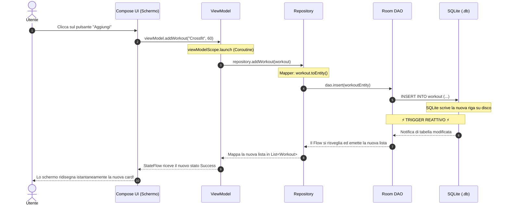

# Capitolo 3: Il Flusso Dati Completo (Dal Database SQLite allo Schermo)

In questo capitolo uniamo tutti i pezzi del puzzle. Spesso i principianti capiscono i singoli concetti isolati (cosa fa un DAO, cosa fa una `data class`, cosa fa una funzione `@Composable`), ma fanno fatica a visualizzare **il filo conduttore** che collega il database SQLite sul disco rigido fino ai pixel colorati che l'utente vede sullo schermo.

Qui seguiamo il viaggio di un dato in entrambe le direzioni:
1. **Flusso di Lettura Reattiva:** Da SQLite allo schermo (con osservazione automatica).
2. **Flusso di Scrittura:** Dal click del mouse dell'utente al salvataggio su disco e successivo auto-aggiornamento.

---

## 1. La Mappa Architetturale del Flusso

Ecco la pipeline completa di FitSlot:

```
┌─────────────────────────────────────────────────────────────┐
│ 1. DISCO FISSO (SQLite .db)                                 │
│    Tabelle fisiche con righe e colonne grezze               │
└──────────────────────────────┬──────────────────────────────┘
                               │ letto da Room
                               ▼
┌─────────────────────────────────────────────────────────────┐
│ 2. DATA LAYER (Room 3 Entity & DAO)                         │
│    WorkoutEntity (con annotazioni di tabella)               │
│    WorkoutDao restituisce Flow<List<WorkoutEntity>>         │
└──────────────────────────────┬──────────────────────────────┘
                               │ tradotto con i Mapper
                               ▼
┌─────────────────────────────────────────────────────────────┐
│ 3. REPOSITORY (Data -> Domain)                              │
│    WorkoutRepositoryImpl traduce in Flow<List<Workout>>     │
└──────────────────────────────┬──────────────────────────────┘
                               │ raccolto dal ViewModel
                               ▼
┌─────────────────────────────────────────────────────────────┐
│ 4. VIEWMODEL (UI State)                                     │
│    Converte il Flow in StateFlow<WorkoutUiState>             │
│    Gestisce le coroutine di scrittura                       │
└──────────────────────────────┬──────────────────────────────┘
                               │ osservato da Compose
                               ▼
┌─────────────────────────────────────────────────────────────┐
│ 5. INTERFACCIA GRAFICA (Compose Screen)                     │
│    collectAsState() legge lo stato e ridisegna la lista     │
└─────────────────────────────────────────────────────────────┘
```

---

## 2. Il Viaggio della Lettura: Come i Dati Arrivano alla UI

Vediamo i 5 file coinvolti in questo flusso, dal più profondo (database) al più visibile (interfaccia).

### Passo 1: L'Entity e il DAO (in `data/local/`)
Il DAO definisce la query SQL e restituisce un flusso continuo (`Flow`):

```kotlin
// shared/.../data/local/dao/WorkoutDao.kt
@Dao
interface WorkoutDao {
    @Query("SELECT * FROM workout ORDER BY created_at DESC")
    fun observeAll(): Flow<List<WorkoutEntity>>
}
```

### Passo 2: Il Mapper (in `data/mapper/`)
Trasforma l'Entity del database nel modello pulito del Dominio:

```kotlin
// shared/.../data/mapper/WorkoutMapper.kt
fun WorkoutEntity.toDomain(): Workout = Workout(
    id = id,
    name = name,
    durationMinutes = durationMinutes,
    notes = notes
)

fun List<WorkoutEntity>.toDomain(): List<Workout> = map { it.toDomain() }
```

### Passo 3: Il Repository (in `data/repository/`)
Prende il flusso delle Entity e usa l'operatore `.map {}` delle coroutine per trasformarlo in un flusso di modelli di dominio:

```kotlin
// shared/.../data/repository/WorkoutRepositoryImpl.kt
class WorkoutRepositoryImpl(
    private val dao: WorkoutDao
) : WorkoutRepository {

    override fun observeAllWorkouts(): Flow<List<Workout>> {
        return dao.observeAll().map { entities ->
            entities.toDomain() // Traduzione pulita verso il dominio
        }
    }
}
```

### Passo 4: Il ViewModel (in `ui/screens/workout/`)
Il ViewModel raccoglie il `Flow` del repository e lo converte in uno **`StateFlow`** tramite `.stateIn()`:

```kotlin
// shared/.../ui/screens/workout/WorkoutListViewModel.kt
class WorkoutListViewModel(
    private val repository: WorkoutRepository
) : ViewModel() {

    // Espone lo stato immutabile che la UI può osservare in ogni momento
    val uiState: StateFlow<WorkoutUiState> = repository.observeAllWorkouts()
        .map { workoutList -> WorkoutUiState.Success(workoutList) as WorkoutUiState }
        .stateIn(
            scope = viewModelScope,
            started = SharingStarted.WhileSubscribed(5_000),
            initialValue = WorkoutUiState.Loading // All'inizio lo schermo è in caricamento
        )
}
```

### Passo 5: La Schermata Compose (in `ui/screens/workout/`)
La schermata osserva lo `StateFlow` convertendolo in uno stato Compose con `collectAsState()`:

```kotlin
// shared/.../ui/screens/workout/WorkoutListScreen.kt
@Composable
fun WorkoutListScreen(viewModel: WorkoutListViewModel) {
    // 1. Osserva lo stato reattivo del ViewModel
    val state by viewModel.uiState.collectAsState()

    // 2. Disegna l'interfaccia a seconda dello stato
    when (val currentState = state) {
        is WorkoutUiState.Loading -> {
            Box(modifier = Modifier.fillMaxSize(), contentAlignment = Alignment.Center) {
                CircularProgressIndicator()
            }
        }
        is WorkoutUiState.Success -> {
            LazyColumn {
                items(currentState.workouts, key = { it.id }) { workout ->
                    Text(workout.name)
                }
            }
        }
        is WorkoutUiState.Error -> {
            Text("Errore: ${currentState.message}", color = MaterialTheme.colorScheme.error)
        }
    }
}
```

---

## 3. Il Viaggio della Scrittura: Cosa Succede Quando l'Utente Clicca "Salva"

Ora seguiamo il cammino inverso: l'utente preme un pulsante per inserire un nuovo allenamento.



### Analisi dettagliata di ciò che accade:

1. **L'evento grafico:** L'utente preme il pulsante. Il composable non sa nulla di database né di coroutine: si limita a chiamare una funzione del ViewModel (`viewModel.addWorkout(name, minutes)`).
2. **Il ViewModel avvia la coroutine:** Poiché l'accesso a disco richiede tempo e non deve bloccare il rendering a 60 fps dello schermo, il ViewModel usa `viewModelScope.launch { ... }`.
3. **Il Repository traduce e delega:** Il repository prende il modello puro `Workout`, usa la funzione `workout.toEntity()` per prepararlo per il database, e chiama la funzione sospensiva `dao.insert(...)`.
4. **Scrittura in SQLite:** Room compila lo statement SQL ed esegue l'operazione sul file SQLite.
5. **Il cerchio si chiude senza codice manuale di refresh:**
   - In molte applicazioni mal strutturate, lo sviluppatore scriverebbe: `dao.insert(...)` e poi chiamerebbe manualmente una funzione `loadDataAgain()`.
   - In FitSlot questo **non serve**: grazie a **Room 3 Invalidation Tracker**, il database stesso avverte il `Flow` di lettura attivo.
   - Il `Flow` riesegue la query in background, il ViewModel aggiorna lo `StateFlow` e Compose aggiorna i pixel a schermo.

---

## 4. Riepilogo del Capitolo

- Il flusso dati segue il pattern **UDF (Unidirectional Data Flow)**: lo stato scende verso la UI, gli eventi risalgono verso il ViewModel.
- Nessuno strato salta il livello intermedio: la UI parla solo con il ViewModel, il ViewModel parla con il Repository, il Repository parla con il DAO.
- Grazie all'accoppiata **Room Flow + Compose StateFlow**, la sincronizzazione dei dati è **automatica al 100%**.

Nel prossimo capitolo approfondiremo l'interfaccia grafica: **Come Funziona Compose Desktop, la Ricomposizione e lo Stato**.
