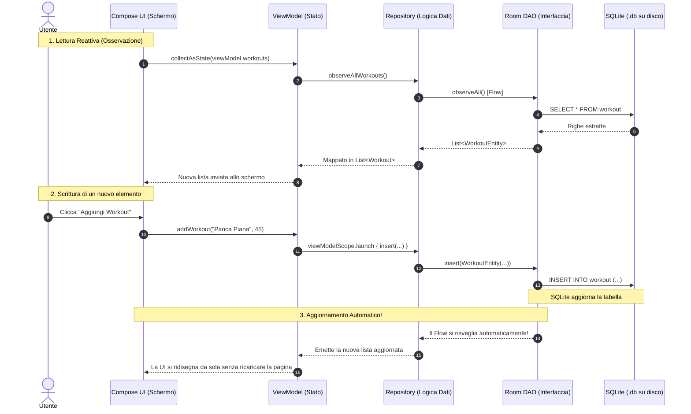

# Capitolo 1: Fondamenti di Room 3 e Architettura

Benvenuto nella documentazione di **Room 3** pensata per il progetto **FitSlot** (Kotlin Multiplatform / Compose Desktop). Questo capitolo parte dalle basi assolute: se non hai mai usato un database o non sai cosa sia un ORM, qui troverai tutto spiegato passo dopo passo, con un linguaggio semplice ma tecnicamente rigoroso.

---

## 1. Il problema: dove finiscono i dati?

Quando avvii un'applicazione scritta in Kotlin, tutte le variabili, le liste e gli oggetti che crei vivono nella **RAM** (la memoria volatile del computer).
- Se aggiungi un allenamento a una lista: `workouts.add(Workout("Panca Piana"))`, questo esiste solo finché l'app è aperta.
- Quando l'utente **chiude l'applicazione** o spegne il computer, la RAM viene liberata e **tutti i dati svaniscono nel nulla**.

Per fare in modo che i dati sopravvivano alla chiusura dell'app (cioè siano **persistenti**), dobbiamo salvarli su un supporto di memorizzazione non volatile: il **disco fisso (SSD/HDD)**.

---

## 2. Cos'è SQLite e perché lo usiamo

Potremmo salvare i dati in un file di testo grezzo (come un file `.txt` o `.json`), ma man mano che l'app cresce emergono problemi enormi:
- Come cerchiamo rapidamente un allenamento tra 100.000 record senza caricare tutto il file in memoria?
- Come colleghiamo un allenamento ai suoi orari (slot) senza duplicare i dati?
- Cosa succede se due parti dell'app provano a scrivere sul file nello stesso momento? Il file si corrompe.

La soluzione standard dell'industria è un **Database Relazionale**.

Nel mondo desktop e mobile, lo standard indiscusso è **SQLite**:
- **Non è un server:** a differenza di MySQL, PostgreSQL o Oracle, SQLite non richiede l'installazione di alcun software o server esterno.
- **È una libreria C integrata:** l'intero motore di database è un piccolo blocco di codice incorporato direttamente nella nostra applicazione.
- **Un singolo file:** l'intero database (tabelle, indici, dati) risiede in un unico file sul disco (ad esempio `fitslot.db`).

SQLite parla il linguaggio **SQL** (Structured Query Language):
```sql
SELECT * FROM workout WHERE duration_minutes > 30 ORDER BY name ASC;
```

---

## 3. Perché non usiamo SQLite "crudo": l'arrivo degli ORM

Se usassimo direttamente SQLite in Kotlin, dovremmo scrivere codice simile a questo (chiamato codice JDBC o SQLite grezzo):

```kotlin
// ❌ Modo vecchio e pericoloso (SQLite "crudo")
val statement = connection.prepareStatement("SELECT id, name, duration FROM workout WHERE id = ?")
statement.setLong(1, 42)
val cursor = statement.executeQuery()

if (cursor.next()) {
    val id = cursor.getLong("id")
    val name = cursor.getString("name") // Se sbagli a scrivere "name", crash a runtime!
    val duration = cursor.getInt("duration")
    val workout = Workout(id, name, duration)
}
```

Questo approccio presenta gravi difetti per un team di sviluppo moderno:
1. **Errori invisibili a tempo di compilazione:** se scrivi `SELECT * FROM worrkout` (errore di battitura), il compilatore Kotlin non può saperlo. L'errore esploderà solo quando l'utente cliccherà quel pulsante durante l'esecuzione dell'app.
2. **Boilerplate infinito:** per ogni query devi estrarre colonna per colonna, convertire i tipi a mano e istanziare gli oggetti.
3. **Rischio di SQL Injection:** se concateni le stringhe invece di usare i parametri preparati, esponi l'app a falle di sicurezza.
4. **Nessuna reattività:** se inserisci un nuovo elemento, l'interfaccia grafica non lo sa e deve ricaricare tutto manualmente.

Qui entra in gioco il concetto di **ORM (Object-Relational Mapping)**: una libreria che fa da interprete e ponte automatico tra il mondo degli **Oggetti Kotlin** (`data class`) e il mondo delle **Tabelle Relazionali SQL**.

---

## 4. Cos'è Room?

**Room** è l'ORM ufficiale sviluppato da Google per l'ecosistema Android e Kotlin.

Invece di farti scrivere codice di basso livello per gestire cursori e connessioni, Room ti permette di definire:
1. Come sono fatte le tabelle usando le normali `data class` Kotlin con annotazioni come `@Entity`.
2. Quali operazioni eseguire sui dati usando interfacce Kotlin con annotazioni come `@Dao`, `@Insert`, `@Query`.
3. Il database complessivo tramite una classe astratta annotata con `@Database`.

A tempo di compilazione, Room analizza il tuo codice Kotlin e le tue query SQL:
- Verifica che le tabelle e le colonne citate nell'SQL **esistano davvero** e abbiano i tipi giusti.
- **Genera automaticamente** per te tutto il codice Kotlin/SQLite noioso e ripetitivo.

---

## 5. La Rivoluzione di Room 3: cosa c'è di nuovo?

Per molti anni Room è esistito solo nella versione 2.x ed era vincolato al sistema operativo Android (package `androidx.room.*`).

**Room 3** (introdotto nel 2024-2025 e stabilizzato con KMP) segna una svolta storica per lo sviluppo software moderno:

### 1. Supporto Completo a Kotlin Multiplatform (KMP)
Room 3 non dipende più dalle classi interne del sistema operativo Android (`android.database.Cursor`, `android.content.Context`).
Ora gira in modo trasparente su:
- **Desktop (JVM):** Windows, macOS, Linux (la nostra target per FitSlot).
- **Android**
- **iOS**
- **Web (Wasm / JS)**

### 2. Addio a Java e KAPT: Solo KSP (Kotlin Symbol Processing)
Room 2 usava spesso KAPT (il vecchio processore di annotazioni Java), che era lento e generava codice Java.
Room 3 usa **esclusivamente KSP**, è scritto al 100% per Kotlin e genera classi Kotlin pure.

### 3. Addio alla Reflection a Runtime: `@ConstructedBy`
Sulle piattaforme native e desktop moderne non è consentito (o è sconsigliato per motivi di performance e sicurezza) usare la Java Reflection per istanziare classi a runtime.
Room 3 introduce il meccanismo `@ConstructedBy` abbinato a un `expect/actual object`: Room genera il codice del costruttore direttamente durante la build.

### 4. Nuovo Package Ufficiale
Per evitare collisioni con la vecchia libreria Room 2 di Android, Room 3 usa il package:
```kotlin
import androidx.room3.*
```
e gli artefatti Gradle `androidx.room3:room3-*`.

### 5. Nuovo Driver SQLite Moderno (`SQLiteDriver`)
In Room 2 l'accesso al database passava attraverso `SupportSQLiteDatabase`.
In Room 3 si utilizza l'interfaccia moderna `androidx.sqlite.SQLiteDriver`. In FitSlot utilizziamo **`BundledSQLiteDriver`**, che include una copia precompilata e identica di SQLite all'interno dell'eseguibile, garantendo che l'app funzioni allo stesso identico modo su qualsiasi computer.

### 6. Fine delle funzioni bloccanti: Coroutine e Flow First
In Room 3 **non è consentito** creare metodi DAO sincroni che bloccano il thread corrente.
Ogni operazione di lettura/scrittura deve essere:
- Una funzione sospensiva (`suspend fun`), eseguita in background su una coroutine; oppure
- Un flusso reattivo (`Flow<T>`), che emette automaticamente i nuovi dati ogni volta che il database viene modificato.

---

## 6. L'Architettura a Tre Pilastri di Room

Ogni volta che lavori con Room, progetterai sempre questi tre componenti fondamentali:

```
┌────────────────────────────────────────────────────────┐
│                      @Database                         │
│  La "centrale operativa": definisce versione, tabelle  │
│  e fornisce i riferimenti ai DAO                       │
└───────────────────────────┬────────────────────────────┘
                            │ espone
                            ▼
┌────────────────────────────────────────────────────────┐
│                        @Dao                            │
│  L'interfaccia delle operazioni (Query, Insert...)     │
│  Tu scrivi la firma, KSP genera l'implementazione      │
└───────────────────────────┬────────────────────────────┘
                            │ manipola
                            ▼
┌────────────────────────────────────────────────────────┐
│                       @Entity                          │
│  La data class Kotlin che rappresenta una riga della    │
│  tabella nel database SQLite                           │
└────────────────────────────────────────────────────────┘
```

| Componente | Ruolo nel codice | Esempio in FitSlot |
|---|---|---|
| **`@Entity`** | Definisce lo schema di una tabella SQLite. Ogni proprietà della data class diventa una colonna. | `WorkoutEntity`, `SlotEntity` |
| **`@Dao`** | Data Access Object. È un'interfaccia che dichiara le funzioni di lettura e scrittura (SQL). | `WorkoutDao`, `SlotDao` |
| **`@Database`** | Classe astratta che eredita da `RoomDatabase`. È il punto di accesso unificato che coordina le tabelle e la connessione al file `.db`. | `AppDatabase` |

---

## 7. Il Ciclo di Vita del Dato: Da SQLite alla UI

Vediamo come un dato viaggia all'interno di FitSlot:



Questo diagramma racchiude il motivo per cui Room 3 è così potente: **la reattività**. Una volta collegata la UI al flusso di dati con `Flow`, qualsiasi inserimento o modifica aggiorna istantaneamente lo schermo senza bisogno di scrivere logica manuale di refresh.

---

## 8. Riepilogo del Capitolo

- I dati nella memoria RAM spariscono alla chiusura dell'applicazione. Per mantenerli nel tempo, li salviamo su disco con **SQLite**.
- **Room 3** è l'ORM moderno per Kotlin Multiplatform che traduce le nostre classi Kotlin in tabelle SQLite ed esegue query sicure a tempo di compilazione.
- Si basa su tre pilastri: **Entity** (i dati), **DAO** (le azioni) e **Database** (la configurazione complessiva).
- In Room 3 il package ufficiale è **`androidx.room3.*`** e tutte le chiamate sono asincrone tramite **`suspend`** e **`Flow`**.

Nel prossimo capitolo vedremo come configurare **Gradle, KSP e Kotlin Multiplatform** per far compilare Room 3 sul nostro target Desktop senza errori.
